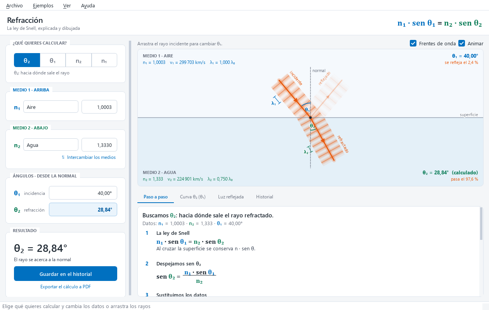
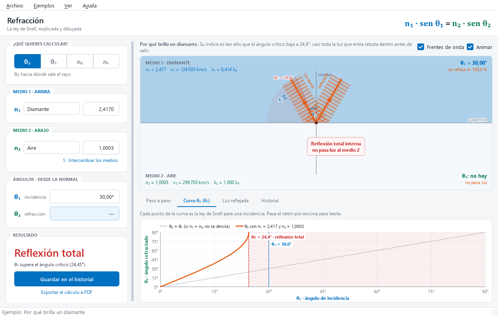
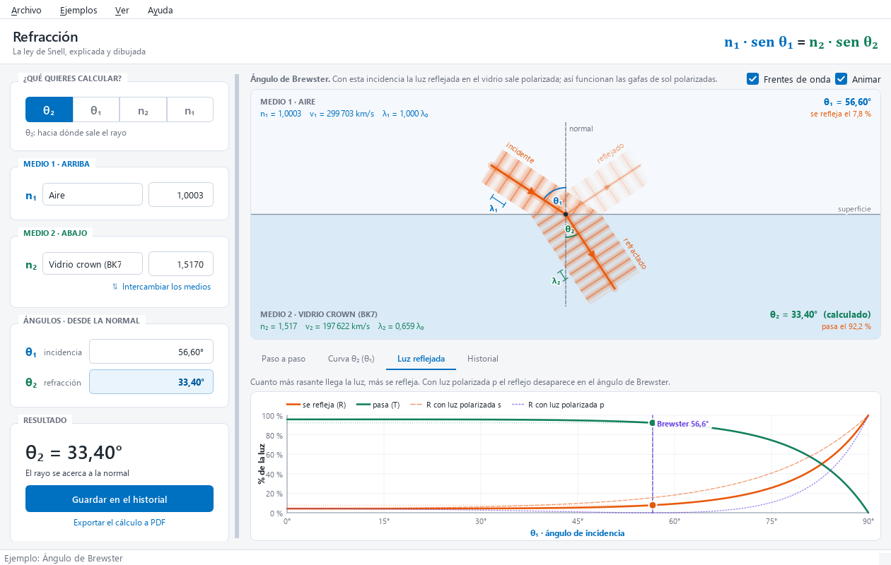

# Refracción

**La ley de Snell, explicada y dibujada.** Calcula cualquiera de las cuatro magnitudes de la
refracción y enseña qué está pasando: el rayo que se dobla, las ondas que se aprietan, la
cuenta paso a paso con tus números y cuánta luz se refleja.



## Qué hace

- **Calcula lo que falta.** Eliges la incógnita (θ₂, θ₁, n₂ o n₁) y la app la despeja de
  n₁ · sen θ₁ = n₂ · sen θ₂ al momento, mientras escribes. Acepta coma o punto decimal.
- **Dibuja la refracción** con los dos medios (más azul cuanto mayor es el índice), la normal,
  los rayos incidente, reflejado y refractado, y sus ángulos. **Los rayos se arrastran con el
  ratón** para cambiar los ángulos y ver la respuesta en directo.
- **Ondas animadas**: al cruzar, la luz no cambia de frecuencia pero sí de velocidad; en el
  medio más denso las ondas se aprietan (λ = λ₀ / n) y, para no romperse en la superficie, el
  haz gira. Una cota de λ₁ y otra de λ₂ junto a cada haz dejan comparar cuánto. Así se ve
  *por qué* se cumple la ley de Snell.
- **Paso a paso** con tus números y las divisiones escritas como fracciones: la ley, el
  despeje, la sustitución, el resultado, la comprobación (los dos lados dan lo mismo) y qué
  significa físicamente.
- **Exportar a PDF** (Ctrl+P): un A4 con el resultado, el diagrama y la curva de la ley de
  Snell en la primera página, y el paso a paso en la segunda. Para entregar un ejercicio o
  imprimirlo.
- **Cuando no hay solución, explica por qué**: reflexión total interna (con el ángulo
  crítico), ángulos refractados imposibles o índices indeterminados (0 / 0).
- **Gráficas**: la curva θ₂(θ₁) entera, con la zona de reflexión total, y la luz reflejada y
  transmitida según las ecuaciones de Fresnel (con el ángulo de Brewster). Al pasar el ratón
  se leen los valores.
- **16 materiales** con su índice (vacío, aire, agua, vidrios, diamante…) y **8 ejemplos
  reales** en el menú: la piscina, la fibra óptica, por qué brilla un diamante, medir el índice
  de un vidrio, el ángulo de Brewster…
- **Historial** de cálculos (se exporta a Excel en CSV) y el diagrama **se guarda como PNG** o
  se copia para pegarlo en un trabajo o una presentación.

Los colores son siempre los mismos en el diagrama, las gráficas y el paso a paso:
θ₁ y n₁ en azul, θ₂ y n₂ en verde, la luz en naranja y el ángulo crítico en rojo.



## Las fórmulas y dónde se ven

| Fórmula | Qué dice | Dónde se ve |
|---|---|---|
| n₁ · sen θ₁ = n₂ · sen θ₂ | Al cruzar la superficie se conserva n · sen θ (ley de Snell) | El diagrama, el paso a paso y la curva θ₂(θ₁) |
| v = c / n | En un medio con más índice la luz va más despacio | Las bandas de cada medio en el diagrama |
| λ = λ₀ / n | La frecuencia no cambia; la longitud de onda, sí | La separación de los frentes de onda y las cotas λ₁ y λ₂ |
| θc = arcsen (n₂ / n₁), si n₁ > n₂ | Pasado este ángulo no sale luz: reflexión total interna | La zona roja del diagrama y de las gráficas |
| θB = arctan (n₂ / n₁) | La luz reflejada sale polarizada; reflejado y refractado forman 90° | La gráfica «Luz reflejada» |
| Rs = ((n₁ cos θ₁ − n₂ cos θ₂) / (n₁ cos θ₁ + n₂ cos θ₂))² | Fracción de luz polarizada s que se refleja (Fresnel) | El grosor del rayo reflejado y la gráfica |
| Rp = ((n₂ cos θ₁ − n₁ cos θ₂) / (n₂ cos θ₁ + n₁ cos θ₂))² | Lo mismo para la polarización p; vale 0 en Brewster | La gráfica «Luz reflejada» |

Los ángulos se miden desde la normal. Los índices de la lista son para luz amarilla (589 nm).



## Uso

```bash
python run.py
```

1. Arriba a la izquierda, elige qué quieres calcular.
2. Escribe los otros tres datos o elige los materiales.
3. Arrastra los rayos del dibujo: todo se recalcula al momento.
4. Abajo tienes el paso a paso, la curva de la ley de Snell, la luz reflejada y el historial.

El estado de la ventana, el historial y los ajustes se guardan en la carpeta de datos del
usuario (`%APPDATA%\DZM\Refracción`); se abre desde Archivo › Abrir carpeta de datos.

## Desarrollo

```bash
python -m venv .venv
.venv\Scripts\activate        # Windows (en Linux/macOS: source .venv/bin/activate)
pip install -e .[dev]
python run.py                 # arrancar la app (o doble clic en Refraccion.bat)
pytest                        # pruebas
pytest --cov=refraccion --cov-branch --cov-report=term-missing
```

### Pruebas

Unas 280 pruebas con pytest, pytest-qt (la ventana se maneja sin pantalla, con
`QT_QPA_PLATFORM=offscreen`) e Hypothesis. Los valores esperados salen de tablas y de cálculos
a mano, no del propio código. Además de los casos normales y los límites (0°, 90°, el ángulo
crítico exacto, n = 0, NaN), hay propiedades que se comprueban con cientos de casos al azar:

- se conserva n · sen θ, o hay reflexión total;
- la luz hace el mismo camino al revés;
- despejar cualquier incógnita devuelve el valor original;
- R + T = 1, Rs ≥ Rp, y se refleja lo mismo por los dos lados (relaciones de Stokes).

El diagrama se prueba leyendo sus píxeles: el refractado sale en su ángulo, desaparece con la
reflexión total y los frentes de onda se aprietan en la proporción de los índices. El PDF se
vuelve a leer con QtPdf para comprobar su texto, sus páginas y que respeta los márgenes. La suite se
ha validado con mutantes: errores metidos a propósito en la física, el formato, la exportación,
el dibujo y la ventana, y todos los detecta alguna prueba.

## Estructura

- `src/refraccion/optica.py`: la física (Snell, ángulo crítico, Brewster, Fresnel). Sin Qt.
- `src/refraccion/explicacion.py`: el paso a paso en texto, con números en español. Sin Qt.
- `src/refraccion/materiales.py` y `ejemplos.py`: los índices de tabla y los ejemplos del menú.
- `src/refraccion/db.py`: SQLite con migraciones numeradas (historial y ajustes). Para cambiar
  el esquema, añade una migración al final de `MIGRATIONS`; no edites las ya entregadas.
- `src/refraccion/exportar.py`: el historial a CSV para Excel en español.
- `src/refraccion/ui/`: la ventana, el diagrama, las gráficas, los campos, el historial y el PDF
  (`informe.py`).
- `packaging/`: el icono (`icono.py`), el ejecutable (PyInstaller) y el instalador (Inno Setup).
- `legado/refraction.pyw`: la versión 1 original, en Tkinter.

## Empaquetar

```bash
python packaging/build.py               # ejecutable en dist/Refraccion/
python packaging/build.py --instalador  # además, dist/Refraccion-<versión>-setup.exe (Inno Setup 6.3+)
dist\Refraccion\Refraccion.exe --comprobar captura.png   # arranca, se revisa y sale
```

`build.py` quita las piezas de Qt que la app no usa (OpenGL, QML, red, lectura de PDF y las
traducciones que no son al español) y al final arranca el ejecutable con `--comprobar`: si
falta algo que sí hacía falta (el plugin SVG, la traducción, el PDF o el CSV), la compilación
falla en vez de entregarse.

La versión está solo en `src/refraccion/__init__.py` (`__version__`). Al publicar una versión
nueva, cámbiala ahí y añade la entrada en `CHANGELOG.md`.

## Ideas para seguir

- **Dispersión**: el índice según el color (Cauchy o Sellmeier) y un prisma que separe el
  arcoíris.
- **Varias capas**: una lámina de caras paralelas y su desplazamiento lateral, o el espejismo
  con un índice que cambia poco a poco.
- **Lentes delgadas**: 1/f = (n − 1)(1/R₁ − 1/R₂) con el trazado de rayos.
- **Modo ejercicios**: problemas al azar con la solución paso a paso para corregirse.
- **Versión web** para el móvil, con el mismo motor.
